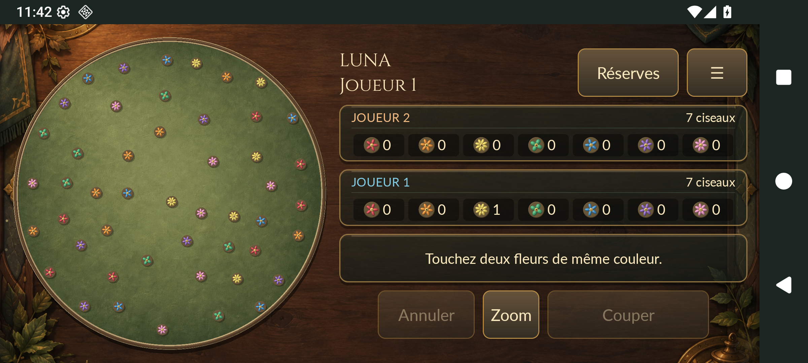

# Luna · Coupe Fleur

Un jeu de stratégie pour **deux personnes sur le même appareil** : choisir deux
fleurs de même couleur, placer ses ciseaux et préparer la récolte finale.
Luna adapte le jeu de société **Coupe Fleur** avec un moteur Python commun
à trois interfaces : PC, navigateur et Android.

Le projet est une **v0.1 jouable**, présentée avec ses sources, ses tests et ses
limites. Il illustre la séparation entre règles, interactions et rendu, ainsi
que la réutilisation d'un moteur entre Pygame et une interface mobile 3D.


Capture actuelle du rendu Pygame en mode SDL `dummy` ; elle ne mesure ni
performances sur écran réel ni qualité sonore.

## Essayer le jeu

- **Navigateur sur ordinateur** : [ouvrir la démo existante](https://luna-coupe-fleur.vercel.app).
  Connexion nécessaire pour charger le runtime ; deux joueurs à la souris,
  aucune sauvegarde après rechargement. Son état de vérification figure dans
  [STATUS.md](STATUS.md).
- **PC** : installer Python 3.13 puis suivre les commandes ci-dessous.
- **Android** : [construire et installer un APK de test](docs/android_build.md).
  Les sources sont fournies ; aucun APK ni installateur n'est joint au dépôt.

| Plateforme | État et technologies | Limites principales |
| --- | --- | --- |
| PC | Partie complète en Python 3.13 / Pygame 2.6.1 ; rendu 2D, animations et sons | Deux joueurs locaux ; pas de sauvegarde ; taille choisie au lancement |
| Web | Portage du client PC avec Pygbag 0.9.3 / WebAssembly | Prototype pour ordinateur ; CDN requis ; compatibilité des autres navigateurs à vérifier |
| Android | Interface Java, OpenGL ES 2.0 et moteur Python via Chaquopy | APK debug à construire ; essais historiques sur émulateur ; téléphone physique à valider |

## Installer et lancer sur PC

Prérequis : **Python 3.13, 64 bits**, et Git pour cloner le dépôt. L'installation
télécharge Pygame depuis PyPI. Le jeu PC fonctionne ensuite hors connexion et
ne demande ni compte, ni clé API, ni fichier `.env`.

Dans PowerShell, depuis le dossier où placer le projet :

```powershell
git clone https://github.com/Fares-Knight/Luna.git
cd Luna
py -3.13 -m venv .venv
.\.venv\Scripts\python.exe -m pip install -e ".[dev]"
.\.venv\Scripts\python.exe -m luna
```

Après installation, **Jouer.bat** lance aussi le jeu sous Windows. Il utilise
uniquement `.venv` et n'installe rien. Sous Linux :

```sh
python3.13 -m venv .venv
.venv/bin/python -m pip install -e '.[dev]'
.venv/bin/python -m luna
```

Python 3.13 est la version de référence. L'exécution graphique sur macOS et la
compatibilité avec Python 3.14 ou supérieur ne sont pas revendiquées.

## Une partie en quelques gestes

1. Le joueur 1 reçoit une fleur au hasard ; les 48 autres sont disposées sur le plateau.
2. Cliquer sur deux fleurs de même couleur dont le segment ne touche aucun autre pion.
3. Cliquer près du segment pour poser le ciseau : le clic est projeté sur la ligne,
   avec une assistance de 12 pixels. Les deux fleurs rejoignent la réserve.
4. Après les 14 coupes, chaque fleur restante revient au propriétaire du ciseau
   le plus proche. Chaque groupe complet de quatre fleurs de même couleur vaut un point.

Une égalité exacte de proximité déclenche un tirage entre les joueurs concernés ;
une égalité des scores donne une partie nulle. Si aucune coupe n'est possible
avant la fin de la phase 1, la partie est annulée et recommencée.
Les [règles originales](RULES.md) et les [décisions v0.1](docs/v0_1_decisions.md)
expliquent cette adaptation, notamment la priorité de la décision de tirage au sort.

**Clic droit / Échap** annule une sélection ; **N** relance une partie ; **S**
ouvre les réglages ; **M** coupe le son ; **Espace** termine les animations.
Sans sélection ni réglages ouverts, Échap ferme le client PC. Volume, animations
réduites, effets sobres et éclats atténués sont disponibles pour la session.

Sur Android, deux touchers sélectionnent les fleurs, un aperçu positionne le
ciseau et **Couper** confirme. Loupe, rail de précision et sauvegarde automatique
complètent ce parcours. [Guide tactile détaillé](docs/android_build.md).



## Choix techniques

- **Règles en Python pur** : état, géométrie et scores se testent sans fenêtre ni audio.
- **Une seule logique de jeu** : `GameController` coordonne les tours ; Android appelle
  le même moteur via un contrat JSON versionné, sans réécrire les règles en Java.
- **Présentation séparée** : les animations lisent des instantanés avant/après la
  coupe ; leur horloge et leur hasard ne modifient ni résultat ni tirages métier.
- **Ressources distribuées avec le paquet** : images, sons et polices sont chargés
  indépendamment du répertoire courant ; les modèles Android sont régénérables.
- **Reprise Android** : mutations vérifiées et sauvegarde atomique avant publication
  de l'état, avec reçus d'actions pour éviter une seconde application d'un même coup.

L'[architecture](docs/architecture.md) décrit les composants et les compromis.
Les dossiers [graphique PC](docs/refonte_graphique.md) et
[mobile 3D](docs/refonte_mobile_3d.md) présentent les ressources et leur provenance.

## Vérifier et construire

Depuis la racine, après installation de l'environnement de développement :

```powershell
.\.venv\Scripts\python.exe -m pytest -q
.\.venv\Scripts\python.exe -m ruff check --select E9,F63,F7,F82 src tests tools web android/app/src/main/python
.\.venv\Scripts\python.exe -m build --wheel
.\.venv\Scripts\python.exe -m pip_audit --local
```

Les tests graphiques emploient SDL `dummy`. Ils vérifient les interactions et
le rendu sans garantir le confort, les performances sur un appareil réel ou
la qualité sonore. Le lint cible les erreurs de code ; aucun contrôle de typage
statique complet n'est configuré.

La [CI](.github/workflows/ci.yml) exécute tests, lint et build Python sur Windows et
Linux. Ses résultats distants et les contrôles manuels figurent dans
[l'état de validation](STATUS.md) et [l'audit de publication](docs/publication_audit.md).
Les builds [Android](docs/android_build.md) et [web](docs/portage_web.md) sont séparés.

## Documentation et suite

- [Architecture, configuration et dépannage](docs/architecture.md)
- [Règles](RULES.md) et [décisions de version](docs/v0_1_decisions.md)
- [Validation actuelle et historique](STATUS.md)
- [Limites et reste à faire priorisé](docs/roadmap.md)
- [Audit de publication](docs/publication_audit.md)
- [Consignes de contribution et collaboration](AGENTS.md)

Il n'y a ni IA, ni jeu en réseau, ni boutique, ni télémétrie applicative.
Les documents de conception contiennent des pistes qui ne sont pas toutes
implémentées ; la feuille de route les distingue des fonctionnalités disponibles.

## Réutilisation

Les contributions du projet sont proposées sous [licence MIT](LICENSE) :
utilisation, modification et redistribution sont permises avec conservation
des mentions de licence. Les polices et composants tiers gardent leurs propres
conditions, recensées dans [THIRD_PARTY_NOTICES.md](THIRD_PARTY_NOTICES.md).
Les peintures ont été générées pour le projet ; leurs prompts sont documentés.
