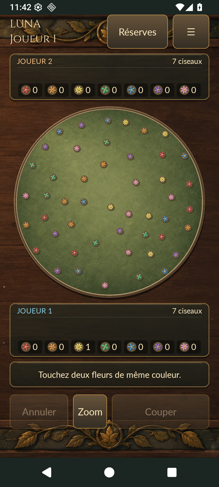

# Luna sur Android : installation et construction

**Sources Android 3D jouables — guide actualisé le 25 octobre 2026.**

Aucun APK ni vidéo binaire n’est joint au dépôt GitHub. Construire le candidat
avec les commandes ci-dessous. Les essais sur émulateur décrits plus bas sont
historiques (septembre/octobre) ; les contrôles de publication actuels sont
répertoriés dans [STATUS.md](../STATUS.md).

Le projet Android utilise une interface Java native et le moteur Python existant.
Le plateau, les sept fleurs et les ciseaux articulés sont des maillages 3D
éclairés par OpenGL ES 2.0. La [refonte mobile 3D](refonte_mobile_3d.md) détaille
les sources éditables, le générateur, les tests et les limites.
Deux personnes jouent sur le même téléphone, dans le même sens.

La revue historique du 9 octobre a validé le candidat 3D après compilation,
156 tests Python, 21 tests JVM et lint. Une partie complète et les interruptions
avaient été contrôlées sur émulateur API 36 ; aucun téléphone physique n’avait
été évalué. Ces résultats ne remplacent pas une nouvelle validation du build.

[Vue portrait](images/android/3d-portrait.png) ·
[Vue paysage](images/android/3d-landscape.png)



Les [anciennes captures portrait](images/android/final-apk-portrait.png) et
[paysage](images/android/final-apk-landscape.png) du 25 septembre sont conservées
comme archives du précédent rendu 2D.

## Installer et jouer

Après construction, le fichier local à transférer sur le téléphone est
`dist/Luna-Android.apk`. Il fonctionne hors connexion.
Android **7.0/API 24 minimum**, **OpenGL ES 2.0**, appareil **64 bits ARM** ; l'APK contient également
`x86_64` pour les émulateurs. Un téléphone limité aux applications 32 bits ne peut
pas utiliser cette version.

1. Copier `Luna-Android.apk` sur le téléphone, puis l'ouvrir depuis le gestionnaire
   de fichiers. Android peut demander d'autoriser l'installation depuis cette
   application : accorder cette autorisation pour installer le fichier.
2. Ouvrir **Luna · Coupe Fleur**, puis **Jouer / reprendre**.
3. Toucher une fleur, puis une seconde de même couleur. Si plusieurs fleurs sont
   proches du contact, choisir explicitement un repère dans le panneau proposé.
4. Toucher ou glisser sur le segment pour prévisualiser le ciseau. Le relâchement
   ne joue pas le coup. Appuyer sur **Couper** pour le confirmer.
5. Utiliser **Zoom** pour la loupe, le rail continu et, si nécessaire, la saisie
   décimale d'une position en pourcentage. Aucun milieu n'est choisi automatiquement.
   Les extrémités 0 et 100 % sont invalides ; toute position intérieure est soumise
   au même moteur que sur PC.

**Modifier** retire la seconde fleur en conservant la première ; **Annuler**
efface ensuite la sélection. **Passer** termine les effets d'une coupe déjà
acceptée. Les contacts reçus pendant la récolte ne sont pas rejoués après elle.

**Menu** donne accès aux règles, aux réserves détaillées, aux réglages et à une
nouvelle partie. **Retour Android** ferme d'abord le dialogue, puis annule une
étape de sélection ; sans sélection il ouvre le menu. Les réglages proposent
son/volume, retour tactile, animations réduites, lueurs et qualité des effets.

La sauvegarde est automatique après chaque mutation acceptée. Fermer ou mettre
le jeu en arrière-plan ne rejoue pas la dernière coupe. Après un redémarrage du
processus, l'état logique sauvegardé réapparaît directement, sans les anciens
effets. Désinstaller l'application ou effacer ses données supprime la sauvegarde.

Cet APK est **signé avec une clé Android debug**, pour une installation locale ;
il ne constitue pas une publication sur Google Play. Une reconstruction sur un
autre poste peut utiliser une autre clé debug et ne pas pouvoir remplacer
l'installation précédente. Conserver le candidat construit et son empreinte pour les essais.

Le script écrit l’empreinte SHA256 du candidat dans le fichier local
`dist/Luna-Android.apk.sha256`. Vérifier le fichier réellement transféré :

```powershell
Get-FileHash -Algorithm SHA256 .\dist\Luna-Android.apk
Get-Content .\dist\Luna-Android.apk.sha256
```

La taille et l’empreinte changent avec le contenu et la clé debug ; aucune valeur
historique n’est présentée comme celle d’un APK actuel.

## Ce qui est implémenté

Le [cahier smartphone](conception_android_smartphone.md) demeure la référence de
conception. Les [règles](../RULES.md) et les
[décisions v0.1](v0_1_decisions.md) restent la référence métier : aucun calcul de
coupe, collision, score ou attribution n'a été réécrit en Java.

| Partie | Comportement livré dans ce candidat |
| --- | --- |
| Composition | Portrait normal et compact ; paysage à deux colonnes ; insets système retirés avant la mise en page |
| Réserves | J2 en haut/J1 en bas, destinations fixes ; détail des quatorze compteurs dans un dialogue |
| Grandes polices | Profil de concentration sur le plateau ; joueur actif visible sous la forme J1/J2 ; réserves accessibles par bouton ; colonne de commandes défilante en paysage |
| Sélection | Deux touchers, seuil de déplacement système, priorité au disque touché puis recherche spatiale à 24 dp ; ambiguïté explicitement résolue, sans filtrage par couleur |
| Précision | Loupe déplaçable et recentrable, listes de fleurs avec repères, rail continu et saisie de pourcentage ; validation Python avant activation de Couper |
| Résultat | Scores et vainqueur fournis par le domaine ; affichage différé jusqu'à la fin des vols de distribution |
| Sauvegarde | État, résultat, message, génération/révision, RNG et derniers reçus d'actions ; écriture privée atomique avant publication |
| Cycle de vie | Pause des animations/audio en arrière-plan, annulation du contact ; état logique préservé lors de rotation et reprise |

Les douze familles visuelles adaptées sont présentes : fil de coupe, lames
articulées et métal clair, éclat d'impact, anneaux, étincelles, pétales, pollen,
rubans, grains d'arrivée, halos, ambiance de lueurs/lucioles et célébration finale.
Les pièces restent petites et les positions métier restent stables pendant la
sélection. Les objets qui volent sont des copies de présentation.

Une coupe dure **780 ms**. Après la dernière paire, la distribution dure
**2 400 ms** : introduction de 180 ms, quatre vagues de cinq départs espacées de 480 ms,
vols de 600 ms, stabilisation de 180 ms. Les derniers vols se terminent 2 040 ms après le
premier départ. Cela borne les transits simultanés à 10 et les rubans à 4. Le
résultat apparaît 3 180 ms après la dernière coupe ; la séquence se termine 3 630 ms
après son début. Les compteurs changent à l'arrivée de leurs fleurs, sans faux
« +1 point » à chaque paire. Le mode réduit termine la présentation en 160 ms.

Les profils économie/standard/riche autorisent au plus **40/80/160 particules**
actives. Les fleurs en transit, rubans et halos sont bornés séparément. Le dessin
ne fait ni appel Python, ni tirage métier, ni émission sonore ; l'horloge et les
marqueurs d'effets progressent avant le rendu. Les effets périmés après une grande
interruption ne sont pas rattrapés sous forme d'une rafale de sons.

## Construire sous Windows

Versions fixées : **JDK 17, Gradle 8.13, Android Gradle Plugin 8.13.2,
Chaquopy 17.0.0, Python 3.13, SDK/Build Tools 36, minSdk 24, targetSdk 36**.
Utiliser un Python de construction 3.13 ; le patch peut différer de celui embarqué par Chaquopy. Les ABI sont `arm64-v8a` et `x86_64`.
Le [plugin Chaquopy](https://chaquo.com/chaquopy/doc/current/android.html) embarque
l'interpréteur ; il ne nécessite ici aucune installation de Pygame ni de paquet
Python externe dans l'APK.

Installer un JDK 17, le SDK Android avec les plateformes 36, build-tools 36.0.0 et
platform-tools, ainsi qu'un Python 3.13 de construction. Le wrapper télécharge
Gradle et les dépendances publiques lors de la première compilation. Les licences
du SDK doivent avoir été acceptées sur le poste.

Depuis la racine du dépôt :

```powershell
.\tools\build_android.ps1 `
  -Jdk "C:\outils\jdk-17" `
  -Sdk "C:\outils\android-sdk" `
  -Python "C:\chemin\python313\python.exe" `
  -Checks
```

Les variables `JAVA_HOME` et `ANDROID_HOME` remplacent les deux premiers
paramètres. Sans `-Python`, le script utilise `.venv/Scripts/python.exe`.
Aucun fichier temporaire de configuration propre au poste n’est consulté.
Le wrapper vérifie le SHA256 de Gradle 8.13 avant sa première installation.

`-Checks` exécute `assembleDebug`, `testDebugUnitTest` et `lintDebug`. Le script
copie ensuite l'APK dans `dist/Luna-Android.apk` et calcule son SHA256.
Il n'installe pas automatiquement l'application sur un téléphone.

Les commandes Gradle correspondantes sont :

```powershell
.\android\gradlew.bat -p android assembleDebug testDebugUnitTest lintDebug `
  "-PbuildPython=C:/chemin/python313/python.exe"
.\.venv\Scripts\python.exe -m pytest -q
```

Avec un appareil de test autorisé et connecté en ADB :

```powershell
adb install -r .\dist\Luna-Android.apk
adb shell am start -n fr.luna.coupefleur/.GameActivity
```

L'identifiant Android est `fr.luna.coupefleur`. Le manifeste ne demande aucune
permission réseau. La sauvegarde se trouve dans le dossier privé de l'application,
`files/luna-save.json`. Aucune sauvegarde cloud ou transfert automatique de données
n'est configuré pour ce candidat.

## Organisation et contrats

`android/app/build.gradle` copie par tâche `Sync` uniquement les sources
`luna/domain`, `luna/application` et l'initialisation du paquet dans un répertoire
de build. Ces fichiers restent les originaux du projet. Les ressources Android
sont lues directement depuis `src/luna/assets` lors de la construction : aucune
copie manuelle divergente n'est entretenue.

| Module | Responsabilité |
| --- | --- |
| `luna_bridge.py` | Contrat JSON, appels au contrôleur, snapshots et sauvegarde |
| `GameSession` | Interpréteur/worker unique par processus, coalescence des aperçus |
| `GameActivity` | Commandes, sélection, dialogues, Retour et cycle de vie |
| `BoardLayout` | Géométrie d'affichage en dp, indépendante des règles |
| `GameSnapshot` | Copie immuable du résultat JSON |
| GameView, ArtResources | Conteneur GL + HUD, modèles OBJ et aperçus calculés |
| BoardRenderer, SceneFrame | Profondeur et éclairage GLES2 ; poses immuables |
| MeshData, MeshMaterials, MeshThumbnail, PanelTexture | Géométrie, matériaux, icônes et habillage |
| `Presentation`, `Particles` | Horloge, vols et effets à budget borné |
| `AudioFeedback`, `Preferences` | Sons, haptique facultative et préférences persistantes |

Le bridge expose `snapshot`, `new_game`, `preview`, `cut`, `export`, `restore`.
Les réponses contiennent une version et un état `after`. Les mutations incluent
un reçu avec `before`, `after`, leur type et, pour une coupe, les deux `cut_ids`.
`generation/revision` sont obligatoires pour les aperçus et mutations. Une
mutation possède un `action_id` unique. Un retry identique encore en cache renvoie
`replayed:true`, l'état **courant** et le reçu historique ; il ne lance aucun
nouvel effet. Réutiliser l'identifiant avec un autre contenu est refusé.
Après éviction des 16 reçus conservés, les anciennes révisions sont refusées.

Une action est exécutée sur une copie indépendante du contrôleur. Le candidat,
son RNG et son reçu sont écrits dans un fichier temporaire, synchronisés, puis
remplacent atomiquement la sauvegarde ; l'état n'est publié qu'ensuite. En cas
d'erreur disque, l'ancien état et son RNG restent actifs. Si le contrôleur applique
une coupe puis échoue à préparer un nouveau jardin, l'état réellement atteint est
sauvegardé et une réponse de récupération l'explique.

La restauration reconstruit les objets sans appeler `new_game`. Elle vérifie les
inventaires, les types, les positions et la cohérence des scores par le domaine,
ainsi que la structure complète du RNG et du cache de reçus avant de publier
l'état chargé. Un RNG tronqué ou un cache `receipts:null` suit le même parcours
de récupération qu'un fichier JSON illisible.
Une sauvegarde illisible n'est pas écrasée par le simple lancement : un message
signale qu'une nouvelle partie est proposée.

## Ressources et licences

La publication GitHub porte sur les sources. Voir les
[notices tierces](../THIRD_PARTY_NOTICES.md) avant une distribution binaire autonome.

Les deux peintures originales, Cinzel, Lato et les dix WAV synthétisés sont ceux
de la [refonte PC](refonte_graphique.md), qui conserve leurs provenances et les
prompts de génération. Les deux licences OFL sont embarquées dans l'APK. Les
fleurs, ciseaux, halos, cadres et icône Android sont dessinés par le projet.
Les menus reprennent le vert forêt, les filets laiton, Cinzel et Lato. Aucun asset
de Hearthstone n'a été copié dans cette application.

## Historique des vérifications du candidat 2D (25 septembre)

Cette section conserve les contrôles de la livraison 2D. Le bilan courant de
la 3D figure dans [refonte_mobile_3d.md](refonte_mobile_3d.md).

Contrôles exécutés sur cet ancien candidat de développement :

- **153 tests Python réussis**, comprenant les 121 tests antérieurs et 32 tests du
  bridge : partie complète, RNG et partie suivante, restauration, égalité exacte,
  endpoints, absence de marge arbitraire, révisions, retries, erreur disque,
  mutation suivie d'exception et sauvegardes corrompues. Les variantes du RNG et du
  cache de reçus testent aussi la récupération par Nouvelle partie et le refus
  atomique d'une restauration explicite invalide.
- **11 tests JVM réussis** : gabarits portrait/compact/paysage/grands textes,
  chronologies 30/60/144 Hz, grand pas de temps, mode réduit, sauts répétés,
  dernière paire distincte des 20 autres fleurs et budgets de particules.
- **Construction et lint réussis** ; lint affiche 0 erreur et 5 avertissements
  concernant des versions de dépendances plus récentes et un texte français
  non externalisé. Les versions de construction sont volontairement fixées.
- APK inspecté : Python 3.13 et moteur attendus, aucun Pygame ni interface PC,
  deux PNG, deux TTF, deux licences OFL et dix WAV. Signature debug v2 contrôlée.
- Essais ADB sur émulateur Android 35 : installation et démarrage, première coupe
  animée, aperçu sans mutation, extrémité du rail refusée, point intérieur accepté,
  partie complète en 14 coupes, 49 fleurs finales uniques et résultat 4–3. Le moteur
  et le RNG ont été comparés après les douze derniers coups de ce parcours ; les
  deux premiers coups avaient fait l'objet des essais manuels précédents.
- Arrêt forcé avec changement de processus, reprise, rotation et Home/reprise :
  sauvegarde complète et RNG inchangés. Captures portrait/paysage inspectées ;
  contrôles accessibles à 200 % sur les profils essayés. Ces observations ne
  constituent pas un audit d'accessibilité TalkBack complet.
- Android 35 en compact 360 × 640 dp : choix ambigu explicite sans mutation,
  coupe réelle puis arrêt forcé pendant sa présentation et reprise exacte.
- Android 36 : installation/lancement, Retour système vers le menu, joueur actif
  visible à 200 %, saisie de 37,1785 % donnant une position domaine de fraction
  0,371785 à 10⁻¹² près, sans mutation avant Couper. Partie complète jouée sur ce
  système également, avec comparaison au moteur/RNG durant le parcours.

La revue indépendante ciblée a donné un **GO final** après les deux corrections
demandées. Elle a réexécuté les **153 tests Python en 8,46 s** et les **11 tests JVM**,
tous réussis. Les essais ciblés suivants ont été réalisés sur l'émulateur
Android 36 avec l'APK d'empreinte
`021d7dfcf2d69daaea70cd40a85a7a3804d1042f24e84558a80773b4a7702816` :

- Nouvelle partie demandée pendant la distribution : nouveau jardin affiché,
  sans réouverture de l'ancien résultat.
- Sauvegardes contenant réellement `rng:[]` ou `receipts:null` : avertissement
  affiché, fichier conservé au lancement, puis récupération par Nouvelle partie.
- Dernière coupe suivie de Passer : résultat normal et 49 fleurs finales,
  avec état métier et RNG strictement identiques à la référence du domaine.
- Aucun crash de l'application relevé dans le journal de crash pendant ces essais.

Aucun téléphone physique n'a encore établi le confort tactile, la qualité
sonore/haptique ou la tenue thermique. La cible 60 Hz
ne constitue pas une mesure de performance garantie : une campagne sur plusieurs
téléphones et des parties longues reste nécessaire. Les API 24–34 sont ciblées
mais n'ont pas toutes été essayées sur appareil.
