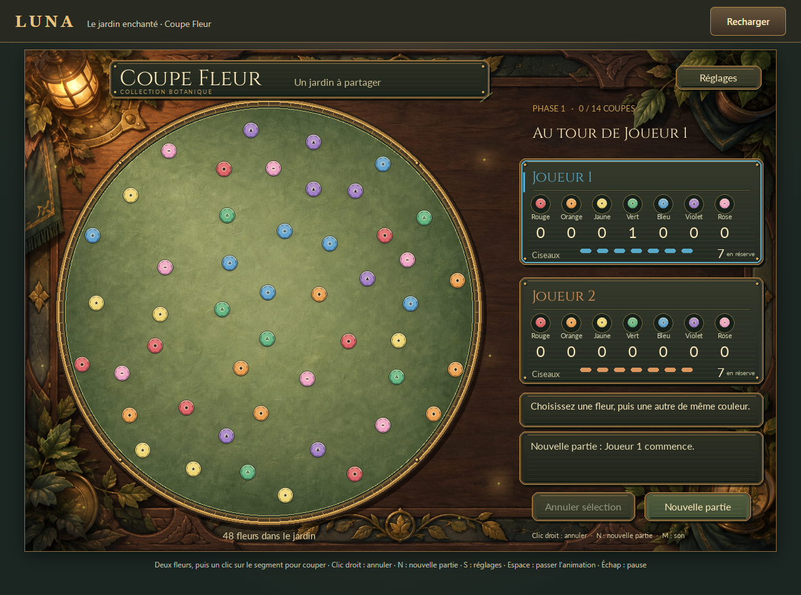
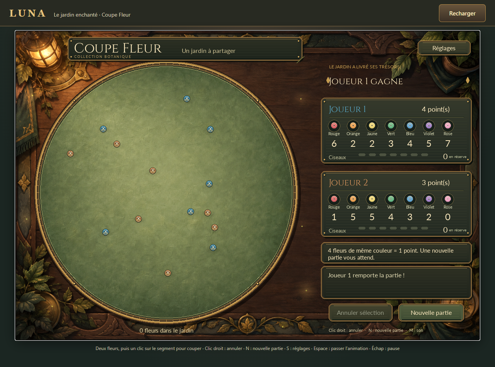
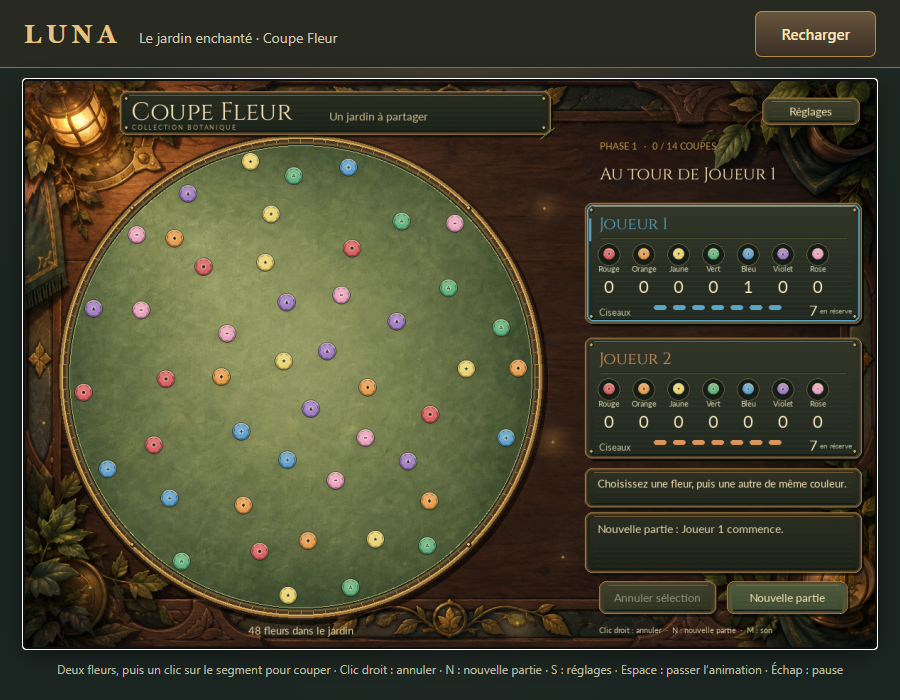

# Portage web de Luna

## État et limites

Le client web réutilise le jeu PC : `web/main.py` adapte la boucle Pygame à
`asyncio`, sans réécrire les règles. C'est un prototype pour **deux personnes
sur le même ordinateur, à la souris**. Il n'a ni serveur de jeu, ni compte,
ni sauvegarde après rechargement. L'interface tactile Android n'est pas portée.

[Ouvrir la démo existante](https://luna-coupe-fleur.vercel.app).
Au 25 octobre 2026, l'URL répond HTTP 200. Le contrôle interactif actuel n'a pas
pu être exécuté avec l'outil de navigateur disponible. Les parties complètes
Chrome décrites ci-dessous sont des observations historiques ; HTTP 200 ne
prouve pas qu'une nouvelle partie fonctionne aujourd'hui. Aucun redéploiement
n'est réalisé dans le cadre de la publication des sources GitHub.

Le runtime Python/pygame-ce provient du CDN Pygbag et BrowserFS 1.4.3 de jsDelivr.
Une connexion est nécessaire au chargement. Ce sont des dépendances externes,
sans garantie de disponibilité. Les fichiers Python et les ressources du jeu
sont téléchargeables par le navigateur ; aucune donnée secrète ne doit y figurer.

## Construire et essayer localement

Depuis la racine du dépôt, avec l'environnement Python 3.13 du README :

```powershell
.\.venv\Scripts\python.exe -m pip install -e ".[web]"
.\.venv\Scripts\python.exe -X utf8 tools/build_web.py
.\.venv\Scripts\python.exe -m http.server 8000 --bind 127.0.0.1 --directory dist/web
```

Ouvrir `http://127.0.0.1:8000`. **Jouer** devient disponible après le chargement.
Échap sans sélection propose une pause ; **Reprendre** conserve la partie et
**Recharger** l'abandonne. Le canevas suit les dimensions affichées au ratio 3:2,
pour conserver l'aimantation de 12 pixels. Masquer l'onglet suspend l'animation ;
les effets sonores périmés ne sont pas rattrapés en rafale à la reprise.

Le [script](../tools/build_web.py) utilise Pygbag **0.9.3**, `--PYBUILD 3.13`,
`--no_opt` et `--disable-sound-format-error`. Ce dernier drapeau conserve les
WAV originaux ; il ne prouve pas leur compatibilité sur tous les navigateurs.
Le runtime web emploie pygame-ce, distinct du Pygame 2.6.1 installé sur PC.

Le build copie uniquement `web/main.py` et `src/luna`, exclut les caches et
vérifie le périmètre de l'archive. Il recrée `build/luna-web` puis `dist/web`,
en conservant un éventuel lien de projet `.vercel` local. Les autres artefacts
de `dist`, notamment un APK Android local, restent préservés. Les sorties de
build et les configurations d'hébergement locales ne sont pas versionnées.

Le [template](../web/template.html) adapte le
[template officiel Pygbag](https://pygame-web.github.io/cdn/0.9.3/default.tmpl).
Ses attributions sont conservées dans les [notices tierces](../THIRD_PARTY_NOTICES.md)
et dans le HTML produit. Le lien BrowserFS d'origine a été remplacé par sa
version explicitement fixée sur jsDelivr après une erreur 404 historique.

## Héberger une copie

Publier **seulement `dist/web`** sur un hébergement statique choisi. Le dépôt,
l'APK Android et les outils de construction n'ont pas à y être copiés. Aucun
serveur Python ne tourne en production. Le fichier `web/vercel.json` précise
les en-têtes de cache si Vercel est retenu ; il ne configure aucun compte.

La publication GitHub des sources ne déploie pas la démo. Pour un futur
hébergement, choisir explicitement compte, projet, domaine et quotas avant
d'utiliser les commandes du fournisseur. Ne pas réutiliser aveuglément une
configuration `.vercel` provenant d'un autre poste.
Voir [la documentation Pygbag](https://pygame-web.github.io/wiki/pygbag/) et
[la configuration des builds Vercel](https://vercel.com/docs/builds/configure-a-build).

Avant chaque déploiement : contrôler l'archive, servir le build neuf, jouer
14 coupes jusqu'au résultat, vérifier nouvelle partie, pause/reprise,
redimensionnement, ressources, audio après clic et erreurs réseau/console.
Reprendre ces contrôles depuis l'URL finale. Les contrôles exécutés pendant
l'audit actuel figurent dans [STATUS.md](../STATUS.md).

## Historique : prototype validé dans Chrome

Les observations suivantes sont conservées du portage initial ; elles ne sont
pas des résultats réexécutés lors de l'audit du 25 octobre :

- Build local réussi, archive limitée à l'entrée et au paquet Luna, 10 WAV,
  2 TTF et leurs licences ; 155 tests Python réussis à cette étape.
- Partie complète de 14 coupes par événements souris : 49 fleurs réparties,
  résultat observé 4–3. Nouvelle partie, taille du canevas et pause/reprise vérifiées.
- Sons disponibles et déclenchements observés ; aucune écoute humaine de validation.
- Python 3.13.12 et pygame-ce 2.5.7 observés dans Chrome ; aucune erreur relevée
  dans le contrôle final. La copie publique avait ensuite été ouverte sans
  connexion au compte d'hébergement et son chargement vérifié.

Ces essais ne valident pas d'autres navigateurs, les téléphones, les performances
sur un autre appareil ou la disponibilité actuelle du runtime distant.







