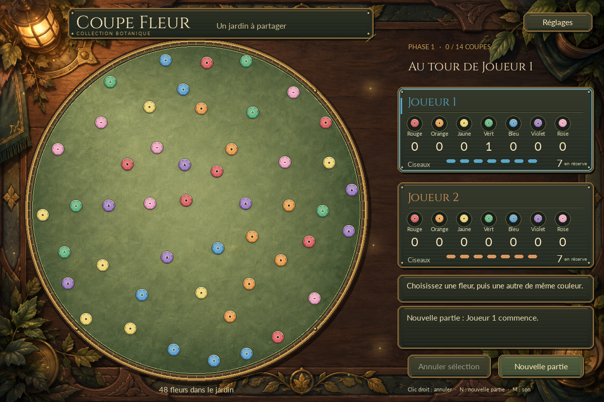

# Refonte graphique livrée : le jardin enchanté

Dossier de livraison historique : **25 septembre 2026**.

Les résultats chiffrés ci-dessous concernent cette livraison. La capture
principale a été actualisée pendant l’audit du 25 octobre (rendu SDL dummy).
Les contrôles actuels sont dans [STATUS.md](../STATUS.md).

Luna conserve les règles de Coupe Fleur et son moteur Python. L'interface Pygame
dispose maintenant d'un plateau peint, de pièces en émail, de réserves encadrées,
d'une mise en scène des récoltes et de sons originaux. La direction s'inspire du
caractère matériel et chaleureux des jeux de plateau fantastiques.

## Jouer et régler la présentation

Lancer **Jouer.bat**, ou depuis le projet :

~~~powershell
.\.venv\Scripts\python.exe -m luna
~~~

Les interactions principales restent identiques : choisir deux fleurs de même
couleur, puis cliquer près du segment. L'aimantation reste de **12 pixels réellement
affichés**, aux dimensions de fenêtre déjà prises en charge. Les pions gardent
leurs rayons et leurs centres métier.

- **Réglages**, en haut à droite, ou **S** : ouvrir le panneau.
- **Son** ou **M** : activer/couper les sons ; boutons **− / +** pour le volume.
- **Animations** : complètes ou réduites.
- **Effets** : riches ou sobres, sans changer les durées des actions.
- **Éclats lumineux** : intensité normale ou atténuée.
- **Espace** : terminer immédiatement la présentation en cours.
- **Nouvelle partie** ou **N** : recommencer, y compris pendant une animation.
- **Annuler sélection**, clic droit ou Échap : annuler une sélection.
  Échap ferme d'abord le panneau des réglages lorsqu'il est ouvert ; sans
  sélection ni panneau, il ferme le jeu.

Ces préférences restent en mémoire pour la session. L'absence de périphérique
audio ne bloque pas une partie.

## Ce qui est implémenté

### Habillage

Le fond peint et le terrain de sauge sont distribués avec le paquet. Le terrain
est masqué dans le cercle exact ; le rebord, les biseaux, les panneaux et les
petites pièces sont dessinés par Pygame puis mis en cache. Sept motifs centraux
complètent les couleurs des fleurs. Les ciseaux distinguent les propriétaires
par la couleur et un petit repère supplémentaire.

Cinzel sert aux titres et Lato à la lecture, y compris aux paragraphes réduits.
Les rectangles des deux boutons historiques, la géométrie du plateau et la
conversion souris restent compatibles avec la v0.1. La fenêtre est adaptée à
l'écran au lancement ; le redimensionnement interactif et les marges uniformes
pour d'autres ratios ne font pas partie de cette livraison.

### Mouvements et effets

Une coupe complète dure **780 ms** : anticipation des lames, fermeture, éclat,
onde, étincelles, pétales, pollen, deux vols en arc décalés, ombres variant avec
la hauteur, rubans et absorption dans les bonnes cases de réserve. Les pions
restent stables pendant le pointage ; les objets volants sont des copies
non interactives après validation.

Les douze familles du cahier sont adaptées au rendu logiciel : fil validé,
lames et reflet, étoile, anneau, étincelles, pétales, pollen, rubans, absorption,
halos, décor vivant et célébration finale. Les boucles périphériques comprennent
lucioles, petites flammes stylisées et mouvements de feuilles ; elles sont
masquées hors du terrain et des zones d'information. Les halos utilisent une
addition RGB locale, et les objets peints une transparence classique.

Après la dernière paire, les vingt fleurs restantes sont présentées en quatre
vagues de cinq. La distribution dure **2400 ms** : annonce de 180 ms, départs
espacés de 480 ms et vols de 600 ms, puis stabilisation de 180 ms. Au maximum
dix fleurs sont simultanément en transit, avec quatre rubans complets. Le score
et le gagnant restent cachés pendant la répartition. La première révélation
commence à 3180 ms après la dernière coupe ; la séquence est libérée à 3630 ms.
Les pétales décoratifs restants peuvent ensuite finir sans bloquer le jeu.

Le mode réduit remplace la séquence par une transition de 160 ms. Un saut
termine la présentation sans réappliquer une coupe ou incrémenter de nouveau
un compteur.

### État et robustesse

Le domaine et l'application n'ont pas été modifiés. Les règles restent dans
[RULES.md](../RULES.md), précisées par les [décisions v0.1](v0_1_decisions.md).

L'interface copie les données visibles avant et après l'appel métier. Les
destinations, tirages et scores viennent du résultat réel. Aucun VFX ne
recalcule une distance ou un score. Les clics reçus pendant une collecte sont
ignorés, jamais rejoués à la fin.

Le remplacement d'une partie invalide les anciennes références, même si les
identifiants des fleurs sont réutilisés. Nouvelle partie, fermeture, saut,
échec de création et erreur après mutation resynchronisent la vue. Le texte
d'annulation automatique reste visible pendant le changement de disposition.

La progression passe par **GameApp.update(dt)** ; **draw()** ne fait progresser
ni horloge ni particules, ne joue pas de son et ne consomme pas de hasard.
Il garde uniquement l'invalidation ponctuelle nécessaire lorsqu'un contrôleur
a été remplacé extérieurement depuis le dernier traitement.

Le hasard visuel est indépendant du RNG métier. Les budgets sont de 160
particules en mode sobre et 320 en mode riche, ambiance comprise ; les petits
effets et rubans possèdent leurs plafonds propres. Les transformations de pièces
ont un cache borné à 128 entrées.

## Organisation du code

| Fichier | Rôle |
| --- | --- |
| [app.py](../src/luna/ui/app.py) | Fenêtre, événements, réglages, coordination et horloge |
| [theme.py](../src/luna/ui/theme.py) | Palette, dimensions et préférences |
| [resources.py](../src/luna/ui/resources.py) | Ressources embarquées, polices et caches |
| [render.py](../src/luna/ui/render.py) | Plateau, pièces, panneaux et composition des effets |
| [animation.py](../src/luna/ui/animation.py) | Snapshots, marqueurs et chronologie des transits |
| [particles.py](../src/luna/ui/particles.py) | Émissions bornées et trajectoires analytiques |
| [audio.py](../src/luna/ui/audio.py) | Banque sonore et repli de synthèse original |

Les assets sont chargés avec importlib.resources, indépendamment du répertoire
courant. Aucune dépendance supplémentaire n'a été ajoutée.

## Vérifications réellement effectuées

- Suite de référence de 98 tests conservée, avec avance du temps explicite
  dans le parcours d'une partie complète.
- **121 tests réussis** via la commande ci-dessous, dont les contrôles ajoutés
  de chronologie à 30/60/144 Hz, grand dt, copies d'état, résultat différé,
  conservation des tirages, égalité exacte de proximité et budgets.
- Contrôles SDL dummy : rendu répété sans progression, double clic,
  nouvelle partie et fermeture pendant transit, erreur de recréation,
  remplacement externe, réglages, audio absent et ressources hors du dépôt.
- Capture et inspection par le principal d'une partie complète à 1200 × 800
  et 900 × 600, dont sélection, coupe, répartition, résultat et réglages ;
  les 49 fleurs finales ont été retrouvées sans doublon.
- Essai par le principal avec le vrai pilote SDL **windows**, fenêtre cachée :
  dix mises à jour/rendus, ressources et audio disponibles, fermeture propre.
  Le son était coupé ; cet essai ne constitue pas une écoute qualitative.
- Chargement depuis un répertoire temporaire extérieur au projet : fond,
  polices et rendu fonctionnels.
- Construction du wheel réussie ; le principal a vérifié les 2 PNG, 2 TTF,
  2 licences OFL et 10 WAV inclus. Exécution Python en mode isolé depuis TEMP,
  avec import direct du wheel confirmé : ressources, audio et update/draw/close
  fonctionnels sans dépendre des fichiers source.
- Revue indépendante favorable, sans problème significatif : **121 tests réussis
  en 7,17 s**. Deux diagnostics ponctuels supplémentaires ont confirmé la parité
  des collections, du RNG, du résultat et de la partie suivante lorsque les
  14 coupes sont toutes sautées avec sauts répétés ; puis la garde du mode réduit,
  active à 159 ms et libérée après 160 ms sans mutation métier supplémentaire.
  Ces deux diagnostics de revue ne sont pas ajoutés à la suite permanente.

~~~powershell
.\.venv\Scripts\python.exe -m pytest -q
~~~

Une mesure préliminaire du principal, sous SDL dummy et avant les dernières
retouches visuelles, a parcouru 998 images de partie complète une fois par
configuration, pour trois configurations, sans attente volontaire de Clock.tick. À 1200 × 800 en mode
riche : p50 3,901 ms, p95 4,225 ms, p99 4,481 ms ; à 900 × 600 en mode riche :
p95 6,140 ms, p99 10,267 ms. Le redimensionnement ajoute du travail.
Le pic observé était de dix transits et soixante particules riches.
Ces nombres sont des temps écoulés sur cet environnement et ce scénario,
**pas une garantie de 60 images/s sur une fenêtre visible ou sur une autre machine**.
La boucle vise 60 Hz ; le ressenti réel et le mixage restent à essayer en jouant.
L'état des validations et de la revue est suivi dans [STATUS.md](../STATUS.md).

## Ressources et provenance

### Images originales

Les deux images ont été générées avec **imagegen, mode builtin**, pour cette
refonte, puis intégrées sans remplacer leurs originaux conservés hors du dépôt.

- images/atelier_background.png : peinture de table, 1536 × 1024.
- images/terrain_texture.png : matière de sauge, masquée dans le cercle.
- Pièces, cadres, ombres et formes de VFX : dessins procéduraux originaux dans
  resources.py et render.py ; aucun fichier graphique extrait de Hearthstone.

Prompt final du fond :

~~~text
Use case: stylized-concept / production videogame background asset. Create one original high-quality hand-painted fantasy tabletop background for Luna, a botanical board game. Landscape 3:2 composition, ideally 1536x1024. True orthographic straight top-down view, no perspective tilt. Rich crafted warm fantasy tavern art direction with the tactile painterly material quality associated with Hearthstone boards, but all ornamentation is original botanical craftsmanship. An old walnut workbench, deep carved warm brown wood (#684432, #33291F), muted sage stone inlays, restrained antique brass (#B58A46), dark forest-green recesses (#1B2622). Beautiful sculpted leaf ornaments, softly worn bevels, strong painterly material separation, warm upper-left lamplight and cool soft shadows. Detail concentrated in a narrow outer border and four corners: small leafy sprigs, botanical carving, one small warm lantern tucked at upper left and a matching brass/glass ornament at lower right. The enormous interior area, especially left two thirds and the right column, must stay quiet, flat, dark-to-medium toned, uncluttered, with subdued wood grain. The game engine will overlay a large circular board on the left and readable reserve panels on the right, so do not paint a board circle, panels, UI frames, buttons, interactive pieces, flowers as pawns, scissors, text, letters, numbers, logos, characters or bright particles. No screenshot mockup. Deliver the background painting itself, edge to edge, fully finished, atmospheric, crisp material details at the perimeter and calm negative space in the middle. Avoid photo realism, busy cracks in the central area, and large high contrast decorations inside the playable areas.
~~~

Prompt final du terrain :

~~~text
Use case: texture for a production 2D fantasy board game. Generate one square 1024x1024 original hand-painted material texture, orthographic top-down, edge-to-edge. This is the quiet playable interior of an enchanted botanical tabletop, not a complete board or UI mockup. Imagine finely worn moss-sage green velvet/felt on a softly padded game surface, with the painterly handcrafted richness of a fantasy tavern card game. Muted olive sage base (#788B61), slightly lighter warm center (#A0AA77), subtle broad hand-painted tonal variation and tiny natural fabric grain; very soft darker vignette toward all edges (#536C50), with warm light from upper left. Delicate material depth and brushwork, not photographic, no sharp cracks, no pattern, no border, no rim, no individual leaves, flowers, objects, symbols, lines, text, logos, glowing specks, particles, strong shadows or landmarks. No white background. The texture must remain restrained and low contrast so small red, yellow, pink, blue and green game tokens read clearly on top. Entire canvas filled with the same painterly sage material, slightly brighter in the center. Designed to be clipped to an exact circular shape by a game engine.
~~~

### Polices et sons

- **Cinzel**, fichier title.ttf : dépôt officiel
  [google/fonts — Cinzel](https://github.com/google/fonts/tree/main/ofl/cinzel).
  [Licence OFL embarquée](../src/luna/assets/fonts/Cinzel-OFL.txt).
- **Lato Regular**, fichier body.ttf : dépôt officiel
  [google/fonts — Lato](https://github.com/google/fonts/tree/main/ofl/lato).
  [Licence OFL embarquée](../src/luna/assets/fonts/Lato-OFL.txt).
- Sons : dix WAV originaux produits hors de la boucle de jeu à partir de la
  synthèse déterministe d'audio.py : select, anticipation, pose, impact, arrival,
  turn, distribution, result, restart et error. Les fichiers sont embarqués ;
  le même générateur sert de repli si un fichier manque. Aucun son de
  Hearthstone n'est utilisé.

## Limites et suite possible

L'ensemble est un rendu Pygame 2D logiciel : relief peint, petites
transformations et composition locale, sans éclairage par normal maps,
réfraction, HDR ni véritable scène 3D. Les sons sont stylisés et courts,
sans musique d'ambiance. Les préférences ne sont pas sauvegardées entre sessions.

L'[analyse artistique](analyse_direction_artistique_hearthstone.md) reste le
cahier d'intention complet, avec des pistes plus avancées que cette première
implémentation. La prochaine validation utile est une partie réelle :
lisibilité des petites fleurs, rythme de la récolte, confort lumineux et
équilibre des sons. Les tests automatiques et captures ne remplacent pas ce ressenti.
